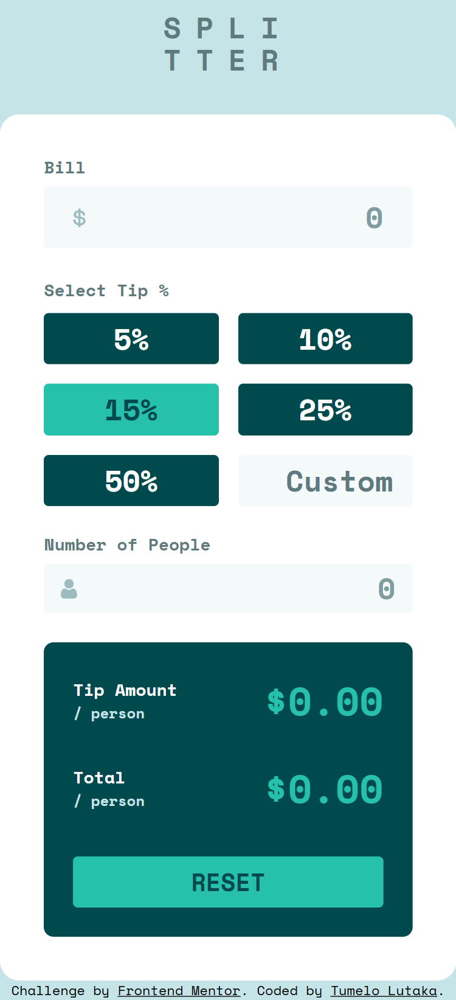
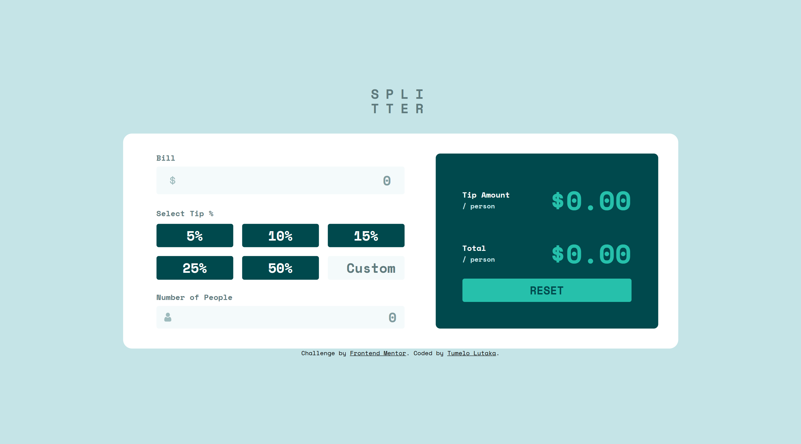

# Frontend Mentor - Tip calculator app solution

This is a solution to the [Tip calculator app challenge on Frontend Mentor](https://www.frontendmentor.io/challenges/tip-calculator-app-ugJNGbJUX). Frontend Mentor challenges help you improve your coding skills by building realistic projects.

## Table of contents

- [Overview](#overview)
  - [The challenge](#the-challenge)
  - [Screenshot](#screenshot)
  - [Links](#links)
- [My process](#my-process)
  - [Built with](#built-with)
  - [What I learned](#what-i-learned)
  - [Continued development](#continued-development)
  - [Useful resources](#useful-resources)
  - [AI Collaboration](#ai-collaboration)
- [Author](#author)
- [Acknowledgments](#acknowledgments)

**Note: Delete this note and update the table of contents based on what sections you keep.**

## Overview

### The challenge

Users should be able to:

- View the optimal layout for the app depending on their device's screen size
- See hover states for all interactive elements on the page
- Calculate the correct tip and total cost of the bill per person

### Screenshot




### Links

- Solution URL: https://github.com/TumeloLutaka/tip-calculator-app
- Live Site URL: https://tumelolutaka.github.io/tip-calculator-app

## My process

### Built with

- Semantic HTML5 markup
- CSS custom properties
- Flexbox
- CSS Grid
- Mobile-first workflow
- CSS Media Queries
- JavaScript

**Note: These are just examples. Delete this note and replace the list above with your own choices**

### What I learned

The biggest lessons I got out out of this challenge was in my JavaScript, specifically with event listener. I learned about some new ones I haven't known about before and encounted specific cases in which to apply them (Blur vs Input).

The most pleasant new thing I learned about was the trick of placing elements within an array manually to be able to run a foreach on them for better DRY as shown below.

```js
[calculatorInputPeople, calculatorFieldsetNumber, calculatorInputBill].forEach(
  (input) => {
    input.addEventListener("keydown", (e) => {
      if (e.key === "-") e.preventDefault();
    });
  },
);
```

## Author

- Frontend Mentor - [@TumeloLutaka](https://www.frontendmentor.io/profile/TumeloLutaka)
- Github - [@TumeloLutaka](https://github.com/TumeloLutaka)
